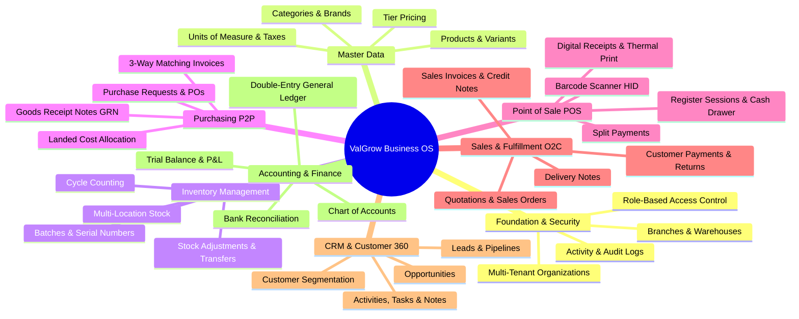
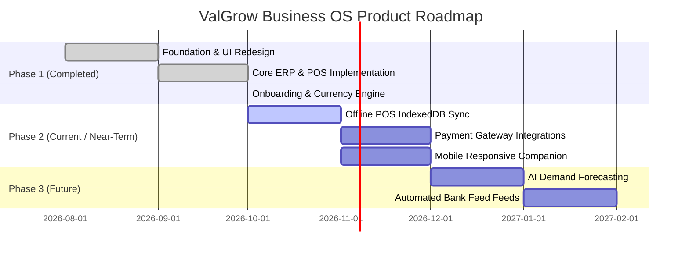

# ValGrow Business OS — Project Documentation

> **Version:** 1.0.0  
> **Repository:** [ValGrow-Labs/valgrow_Business_os](https://github.com/ValGrow-Labs/valgrow_Business_os)  
> **Last Updated:** October 2026  
> **Target Environment:** Multi-tenant Cloud & On-Premise Enterprise  

---

## 1. Executive Summary

**ValGrow Business OS** is a unified, enterprise-grade, multi-branch Business Operating System (ERP, POS, CRM, and Financial Accounting) built for modern retail, wholesale, manufacturing, and distribution businesses. 

Unlike fragmented business tools that rely on fragile third-party integrations, ValGrow Business OS unifies **Point of Sale (POS)**, **Multi-Warehouse Inventory**, **Procurement (P2P)**, **Sales & Fulfillment (O2C)**, **Omnichannel CRM**, and **Double-Entry Financial Accounting** into a single multi-tenant platform with real-time ledger updates and strict organizational data isolation.

### Core Value Pillars
- **Single Source of Truth:** Inventory movements, sales receipts, and purchase orders automatically update general ledger accounts, stock levels, and audit logs.
- **Strict Multi-Tenancy & RBAC:** Every query is tenant-scoped via organizational tokens and verified with fine-grained role-based permission policies.
- **Enterprise-Grade User Experience:** Built with TanStack Start, React 19, Tailwind CSS v4, Lucide icons, Motion animations, and a unified dark/light enterprise design system.
- **Offline & Hardware Ready:** POS supports USB HID barcode scanners, cash drawer tracking, thermal receipt printing, and rapid tender splits.
- **Global Operation Ready:** Built-in internationalization engine supporting 150+ currencies with real-time locale formatting and multi-warehouse routing.

---

## 2. Architecture Overview

ValGrow Business OS follows a modular monorepo architecture with clean separation of concerns between client presentation, application APIs, and the relational persistence layer.

### 2.1 High-Level Architecture Diagram

```mermaid
graph TD
    subgraph Client Tier ["Client Tier (Browser / POS Terminal)"]
        Browser["TanStack Start Web App (apps/web)"]
        BarcodeScanner["USB HID Barcode Scanner"]
        ThermalPrinter["Thermal Receipt Printer"]
        BarcodeScanner -->|Keystroke Emulation| Browser
        Browser -->|Print API| ThermalPrinter
    end

    subgraph Edge & Routing ["Edge & Reverse Proxy"]
        VercelEdge["Vercel Edge Gateway / Nitro Proxy"]
        Browser -->|HTTPS :8080 or :443| VercelEdge
    end

    subgraph Application Tier ["Application Tier (apps/api)"]
        NestApp["NestJS 11 Core Engine"]
        VercelEdge -->|/api/* (Forwarded HTTP)| NestApp
        
        AuthModule["Auth & JWT Guard"]
        TenantInterceptor["Tenant Scope Interceptor (X-Organization-Id)"]
        RBACGuard["Permissions Guard"]
        BusinessModules["58 Domain Modules (POS, Inventory, Accounting, CRM, etc.)"]
        
        NestApp --> AuthModule
        AuthModule --> TenantInterceptor
        TenantInterceptor --> RBACGuard
        RBACGuard --> BusinessModules
    end

    subgraph Data Tier ["Data Tier"]
        PrismaORM["Prisma ORM Client v6"]
        PostgresDB[("PostgreSQL 16 Database\n(89 Relational Tables)")]
        
        BusinessModules --> PrismaORM
        PrismaORM --> PostgresDB
    end
```

### 2.2 Monorepo Structure

The repository is organized as an **npm workspaces** monorepo:

```
valgrow_Business_os/
├── apps/
│   ├── web/                     # Frontend Application (TanStack Start + React 19 + Vite 8)
│   │   ├── public/              # Static assets, logos, user manual
│   │   ├── src/
│   │   │   ├── components/      # Reusable UI primitives & business dialogs
│   │   │   ├── hooks/           # TanStack Query custom hooks (useProducts, usePOS, etc.)
│   │   │   ├── lib/             # API client, currencies engine, theme provider
│   │   │   └── routes/          # 77 file-based TanStack Router pages
│   │   ├── package.json
│   │   └── vite.config.ts
│   └── api/                     # Backend API (NestJS 11 + Prisma ORM + Passport JWT)
│       ├── src/
│       │   ├── common/          # Guards, decorators, interceptors, DTO filters
│       │   ├── modules/         # 58 business domain modules
│       │   ├── prisma/          # Prisma database service & extensions
│       │   ├── seed/            # Development database seed scripts
│       │   ├── app.module.ts    # Central NestJS module registry
│       │   └── main.ts          # API entry point & CORS configuration
│       ├── test/                # E2E integration test suites
│       └── package.json
├── prisma/
│   ├── schema.prisma            # Comprehensive relational schema (89 models)
│   └── migrations/              # Immutable SQL migration history
├── docs/                        # Deployment specs, user manual, superpowers plans
├── docker-compose.yml           # PostgreSQL container orchestration
├── .env.example                 # Environment configuration template
└── package.json                 # Monorepo root workspace configuration
```

### 2.3 Multi-Tenant Isolation Strategy

Tenant isolation is enforced at every layer of the application:
1. **Request Identification:** Every authenticated client request sends the active organization identifier via the `X-Organization-Id` HTTP header.
2. **JWT Association:** The `JwtAuthGuard` validates user identity and ensures the requesting user is an active member of the designated organization (`OrganizationMember`).
3. **Tenant Interceptor & Services:** Backend services explicitly scope queries with `organizationId` filters. Cross-tenant reads and mutations are rejected with `403 Forbidden`.
4. **Foreign Key Integrity:** Cascading foreign keys in PostgreSQL ensure that deleting or archiving an organization or branch cleans up or archives dependent records reliably.

### 2.4 Deployment & Infrastructure Topology

```
                  ┌──────────────────────────────────────────────┐
                  │                 DNS / CDN                    │
                  │             https://app.valgrow.com          │
                  └──────────────────────┬───────────────────────┘
                                         │
                         ┌───────────────┴───────────────┐
                         ▼                               ▼
                 [Static / SSR Web]              [API Requests]
                 Vercel / Cloudflare             /api/* routes
                 (apps/web on Nitro)             Reverse Proxied
                         │                               │
                         │                               ▼
                         │               ┌───────────────────────────────┐
                         │               │  Coolify Server (Ubuntu VPS)  │
                         │               │  https://api.valgrow.com      │
                         │               │  Docker Container (apps/api)  │
                         │               └───────────────┬───────────────┘
                         │                               │ Private Net
                         │                               ▼
                         │               ┌───────────────────────────────┐
                         │               │  PostgreSQL 16 Container      │
                         │               │  (Port 5432, Internal Only)   │
                         └──────────────►│  Automatic Daily S3 Backups   │
                                         └───────────────────────────────┘
```

---

## 3. Technology Stack

### 3.1 Frontend (`apps/web`)

| Layer / Concern | Technology | Justification & Role |
| :--- | :--- | :--- |
| **Framework** | **TanStack Start (Vite 8 + Nitro)** | Ultra-fast file-based routing, instant HMR, SSR and SPA dual-mode support. |
| **Language** | **TypeScript 5.8** | Strict end-to-end type safety across queries, mutations, and payloads. |
| **UI Library** | **React 19** | Modern concurrent rendering, transitions, and component primitives. |
| **Styling & CSS** | **Tailwind CSS v4 + LightningCSS** | High-performance CSS transform engine with custom enterprise tokens. |
| **Component Kit** | **Radix UI Primitives + Shadcn UI** | WAI-ARIA accessible, keyboard-navigable enterprise components. |
| **State & Caching** | **TanStack Query v5 (@tanstack/react-query)** | Server state caching, background refetching, and optimistic updates. |
| **Animations** | **Motion v14 (Framer Motion engine)** | Micro-interactions, smooth page transitions, and onboarding spotlight tours. |
| **Charts & Metrics**| **Recharts** | Declarative analytics charts for revenue, inventory turnover, and sales trends. |
| **Forms & Validation**| **React Hook Form + Zod** | Controlled/uncontrolled form handling with type-inferred validation schemas. |
| **Icons** | **Lucide React** | Clean, consistent, lightweight SVG icon set. |
| **Notifications** | **Sonner** | Modern toast notification stack with queue management. |

### 3.2 Backend API (`apps/api`)

| Layer / Concern | Technology | Justification & Role |
| :--- | :--- | :--- |
| **Framework** | **NestJS 11** | Modular, enterprise architecture with dependency injection, decorators, and middleware. |
| **Platform** | **Node.js 22 LTS / Express** | High-throughput asynchronous event loop runtime. |
| **ORM & Client** | **Prisma ORM 6.4** | Type-safe query builder, automated schema migrations, and relational modeling. |
| **Authentication** | **Passport.js + JWT + bcrypt** | Token-based auth with HttpOnly cookies, refresh token rotation, and 12-round bcrypt. |
| **Validation** | **class-validator + class-transformer** | Declarative DTO input sanitization, type transformation, and strict whitelisting. |
| **Document Engine**| **PDFKit** | Headless PDF generation for purchase orders, invoices, and sales receipts. |
| **Spreadsheet Engine**| **ExcelJS** | Native XLSX and streaming CSV data exports. |
| **Testing** | **Jest + Supertest** | Comprehensive unit, e2e, and tenant-isolation testing suites. |

### 3.3 Database & Infrastructure

| Layer / Concern | Technology | Justification & Role |
| :--- | :--- | :--- |
| **Relational DB** | **PostgreSQL 16 Alpine** | Robust ACID transactional database supporting complex joins and foreign keys. |
| **Containerization**| **Docker & Docker Compose** | Reproducible development, testing, and production container environments. |
| **Deployment** | **Coolify + Vercel** | Self-hosted backend container deployment paired with global edge frontend hosting. |

---

## 4. Business Domains & Feature Breakdown

ValGrow Business OS is organized into **8 core business domains**, backed by 89 relational database tables and 58 NestJS backend modules.



---

### 4.1 Foundation & Multi-Tenancy

- **Multi-Tenant Scoping:** Supports multiple isolated organizations within a single deployment. Users can belong to multiple organizations with distinct roles in each.
- **Hierarchical Structure:** `Organization` ➔ `Branches` ➔ `Departments` ➔ `Teams`.
- **Granular RBAC:** Permissions are structured by `resource.action` (e.g., `pos.sale`, `inventory.adjust`, `users.create`). Custom roles can be tailored alongside system roles (`Owner`, `Administrator`, `Branch Manager`, `Cashier`).
- **Audit & Activity Logs:** Complete audit trail tracking user IDs, actions, entity IDs, metadata, and timestamps for every key business transaction.
- **Global Search & Command Bar:** Instant system-wide navigation via `Ctrl + K` or `Cmd + K` command palette.

---

### 4.2 Master Data Management

- **Product Catalog:** Unified management of standard, variable, serialized, and batched products.
- **Product Variants:** Flexible attributes (size, color, material, weight) with individual SKUs and barcodes.
- **Tier & Currency Pricing:** Multi-currency support and customer tier pricing (Retail, Wholesale, VIP).
- **Tax Configuration:** Single and compound tax rates with localized tax IDs (GST, VAT, Sales Tax).
- **Units of Measure:** Base and conversion units (e.g., pieces, boxes, kilograms, liters).

---

### 4.3 Inventory & Warehouse Operations

- **Multi-Warehouse & Bin Locations:** Track stock across physical warehouses, aisle/rack/shelf/bin locations.
- **Real-Time Stock Movements:** Automatic FIFO/Average cost tracking via `InventoryCostLayer`.
- **Serial & Batch Tracking:** Expiry dates, batch numbers, and individual serial number lifecycle tracking.
- **Stock Transfers:** Two-stage transfer flow (Dispatch ➔ In-Transit ➔ Receive) between branches or warehouses.
- **Stock Adjustments & Write-Offs:** Reconcile variances due to breakage, shrinkage, or audit discrepancies.
- **Cycle Counts:** Automated physical stock auditing with variance reporting and automatic ledger reconciliation.

---

### 4.4 Procurement & Purchasing (Procure-to-Pay)

```
[Purchase Request] ──► [Purchase Order] ──► [Goods Receipt (GRN)] ──► [Supplier Invoice] ──► [Payment]
                             │                      │                         │
                             ▼                      ▼                         ▼
                     Supplier Confirmation    Stock Increase            3-Way Match &
                     & PDF Generation         & Cost Allocation         Ledger Entry
```

- **Purchase Requests (PR):** Departmental requisitions with multi-tier approval workflows.
- **Purchase Orders (PO):** Vendor POs with currency conversion, terms, delivery dates, and auto-generated PDFs.
- **Goods Receipt Notes (GRN):** Warehouse receiving with line-item quantity inspection, batch/serial capture, and discrepancy tracking.
- **Landed Cost Allocation:** Distribute shipping, customs, freight, and handling costs across received items to accurately reflect true inventory cost.
- **3-Way Matching:** Automated reconciliation between Purchase Order, Goods Receipt, and Supplier Invoice to prevent overbilling.
- **Supplier Payments:** Full and partial payments with check, wire, cash, or credit support.

---

### 4.5 Point of Sale (POS)

- **Register Sessions:** Opening cash floats, cash drops, suspended sessions, and end-of-day cash drawer reconciliation.
- **Hardware Integration:** Native plug-and-play support for **USB HID barcode scanners** (global keystroke scanner listener) and thermal receipt printers.
- **Cart Management:** Hold and resume multiple carts, customer assignment, discounts, and custom tax overrides.
- **Payment Tenders:** Cash, card, digital wallet, and split tender payments.
- **Instant Receipt Generation:** Print-optimized thermal receipts and PDF export.

---

### 4.6 Sales & Distribution (Order-to-Cash)

- **Quotations:** Estimate creation with expiry dates, status tracking, and one-click conversion to Sales Orders.
- **Sales Orders:** Backorder handling, credit limit validation, and fulfillment routing.
- **Delivery Notes:** Dispatch documentation with vehicle details, driver info, and signature capture.
- **Sales Invoices:** Automated tax invoices linked to orders and deliveries with overdue tracking.
- **Credit Notes & Returns:** Manage customer returns, restocking fees, and credit balance issuance.

---

### 4.7 Customer Relationship Management (CRM)

- **Kanban Pipelines & Stages:** Drag-and-drop opportunity pipelines with customizable deal stages and probability ratings.
- **Leads & Conversion:** Lead capture, qualification, scoring, and one-click conversion into Customers + Opportunities.
- **Customer 360° Profile:** Unified view of customer purchase history, outstanding receivables, open orders, support notes, and assigned tags.
- **Activity & Task Management:** Schedule calls, meetings, reminders, and follow-up tasks linked to accounts.

---

### 4.8 Financial Accounting & Double-Entry Ledger

```
                               ┌────────────────────────────────┐
                               │     Business Transactions      │
                               │  (POS, Invoices, GRN, Payments)│
                               └───────────────┬────────────────┘
                                               │ Auto-Generates
                                               ▼
                               ┌────────────────────────────────┐
                               │         Journal Entry          │
                               │  Debit Lines == Credit Lines   │
                               └───────────────┬────────────────┘
                                               │
                         ┌─────────────────────┴─────────────────────┐
                         ▼                                           ▼
             ┌───────────────────────┐                   ┌───────────────────────┐
             │    General Ledger     │                   │  Sub-Ledgers (AR/AP)  │
             │   Chart of Accounts   │                   │    Aging Schedules    │
             └───────────┬───────────┘                   └───────────────────────┘
                         ▼
        ┌────────────────────────────────────────────────────────────┐
        │                    Financial Statements                    │
        │      Trial Balance  │  Profit & Loss  │  Balance Sheet     │
        └────────────────────────────────────────────────────────────┘
```

- **Double-Entry Engine:** Strict balanced journal validation (`Debit Total == Credit Total`). Manual journal entries, recurring journals, and reversal capabilities.
- **Standard Chart of Accounts (COA):** Pre-seeded categorized structure covering Assets, Liabilities, Equity, Revenue, and Expenses.
- **Sub-Ledgers:** Accounts Receivable (AR) and Accounts Payable (AP) sub-ledgers with automated 30/60/90+ day aging reports.
- **Financial Statements:** Real-time generation of **Trial Balance**, **Profit & Loss (Income Statement)**, and **Balance Sheet**.
- **Bank Reconciliations:** Import bank statements and match transactions against internal bank accounts.

---

### 4.9 Enterprise Design System & Onboarding

- **Design System:** Built on customized Tailwind CSS v4 tokens, Lucide icons, and modern responsive layouts.
- **First-Time User Onboarding:** Interactive Spotlight product tour, welcome modal dialog, and contextual getting-started checklist.
- **Dedicated Documentation & Help:** Built-in [User Manual](file:///Users/rishivarma/valgrow_Business_os/apps/web/public/valgrow-user-manual.html) and per-module "How This Works" interactive guides.

---

## 5. Current Progress & Implementation Status

### 5.1 Domain Implementation Status Matrix

| Module / Domain | Frontend UI | Backend API | Database Schema | E2E Tests | Status |
| :--- | :---: | :---: | :---: | :---: | :---: |
| **Authentication & Profile** | ✅ Complete | ✅ Complete | ✅ Complete | ✅ Complete | **Production Ready** |
| **Organization & Branches** | ✅ Complete | ✅ Complete | ✅ Complete | ✅ Complete | **Production Ready** |
| **Users, Roles & RBAC** | ✅ Complete | ✅ Complete | ✅ Complete | ✅ Complete | **Production Ready** |
| **Product Master Catalog** | ✅ Complete | ✅ Complete | ✅ Complete | ✅ Complete | **Production Ready** |
| **Inventory & Warehouses** | ✅ Complete | ✅ Complete | ✅ Complete | ✅ Complete | **Production Ready** |
| **Purchasing & GRN (P2P)** | ✅ Complete | ✅ Complete | ✅ Complete | ✅ Complete | **Production Ready** |
| **POS Register & Barcode** | ✅ Complete | ✅ Complete | ✅ Complete | ✅ Complete | **Production Ready** |
| **Sales & Invoicing (O2C)** | ✅ Complete | ✅ Complete | ✅ Complete | ✅ Complete | **Production Ready** |
| **Customers & CRM** | ✅ Complete | ✅ Complete | ✅ Complete | ✅ Complete | **Production Ready** |
| **Accounting & Ledger** | ✅ Complete | ✅ Complete | ✅ Complete | ✅ Complete | **Production Ready** |
| **Reports & Analytics** | ✅ Complete | ✅ Complete | ✅ Complete | ✅ Complete | **Production Ready** |
| **Onboarding & Help Center**| ✅ Complete | ✅ Complete | ✅ Complete | ✅ Complete | **Production Ready** |

---

### 5.2 Key Recent Milestones (October 2026)

1. **International Currency & Locale Engine:** Added support for 150+ international currencies with dynamic symbol placement, decimal handling, and real-time formatting across POS, Invoices, and Reports.
2. **Unified Organization Setup:** Implemented automated onboarding wizard that creates organization, head office branch, main warehouse, and default chart of accounts in a single atomic transaction.
3. **USB HID Barcode Scanner Integration:** Added global keypress buffer listener to the POS terminal, allowing any standard USB/Bluetooth barcode scanner to scan items instantly without requiring manual search.
4. **Data Exports Engine:** Added native CSV data exports for Products, Inventory, Customers, and Sales, along with PDFKit document generation for Purchase Orders and Tax Invoices.
5. **Interactive Spotlight Tour:** Integrated multi-step product tour using Motion v14 to guide new administrators through their first branch, product, and sales transactions.

---

## 6. Developer Setup & Local Execution

### 6.1 Prerequisites
- **Node.js**: `v20.x` or `v22.x` LTS
- **npm**: `v10.x` or higher
- **Docker & Docker Compose**: For local PostgreSQL container

### 6.2 Quick Start Guide

```bash
# 1. Clone repository
git clone https://github.com/ValGrow-Labs/valgrow_Business_os.git
cd valgrow_Business_os

# 2. Check out working branch
git checkout rishi

# 3. Install all monorepo dependencies
npm install

# 4. Configure environment variables
cp .env.example .env

# 5. Start PostgreSQL database container
docker compose up -d

# 6. Apply database migrations & generate Prisma client
npx prisma migrate deploy
npx prisma generate

# 7. Seed sample data (Organization, Users, Roles, Chart of Accounts)
npm run seed

# 8. Start development servers concurrently
npm run dev
```

### 6.3 Service Ports & Endpoints

| Service | Protocol / Port | Local Endpoint | Description |
| :--- | :--- | :--- | :--- |
| **Frontend Web** | HTTP / `8080` | `http://localhost:8080` | TanStack Start application |
| **Backend API** | HTTP / `3001` | `http://localhost:3001` | NestJS REST API |
| **API Health Check**| HTTP / `3001` | `http://localhost:3001/health` | Service health status check |
| **PostgreSQL DB** | TCP / `5434` | `localhost:5434` | PostgreSQL container (`valgrow_db`) |

### 6.4 Default Seed Credentials

| Role | Email | Password |
| :--- | :--- | :--- |
| **Super Admin / Owner** | `alex.verma@valgrow.dev` | `DevelopmentPass123!` |
| **Manager** | `riya.placeholder@valgrow.dev` | `DevelopmentPass123!` |
| **Cashier / Staff** | `sam.placeholder@valgrow.dev` | `DevelopmentPass123!` |

---

## 7. Quality Assurance, Security & Best Practices

- **Strict Type Safety:** Full TypeScript coverage with zero implicit `any` in core business pathways.
- **Database Indexing:** Compound indexes on foreign keys (`organizationId`, `branchId`, `productId`, `warehouseId`, `customerId`) and search fields (`sku`, `barcode`, `slug`, `email`).
- **Security Protections:**
  - Password hashing with 12-round bcrypt salt.
  - HttpOnly, SameSite cookies for JWT storage to prevent XSS credential theft.
  - CORS origin whitelisting matching production domains and local dev ports.
  - Input parameter whitelisting (`forbidNonWhitelisted: true`) preventing prototype pollution and mass-assignment attacks.
- **E2E Test Coverage:** Comprehensive Jest integration tests verifying multi-tenant isolation, organization onboarding, and transaction integrity.

---

## 8. Strategic Roadmap



1. **Offline POS with IndexedDB Sync:** Enable continuous offline point of sale operation during network outages with background transaction queue synchronization.
2. **Payment Gateway Integrations:** Direct terminal payment integrations with Stripe Terminal, Square, and local UPI/card payment providers.
3. **AI Inventory Demand Forecasting:** Machine learning predictive stock ordering based on historical sales velocity, lead times, and seasonal demand patterns.
4. **Automated Bank Feeds:** Direct Open Banking API synchronization for automated bank account reconciliation.

---
*Document maintained by the ValGrow Engineering Team.*
